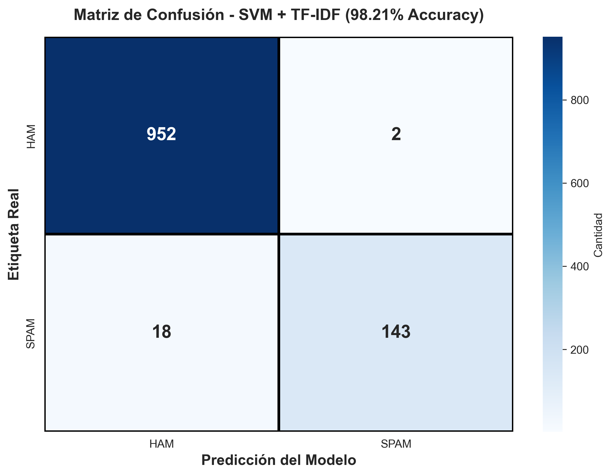
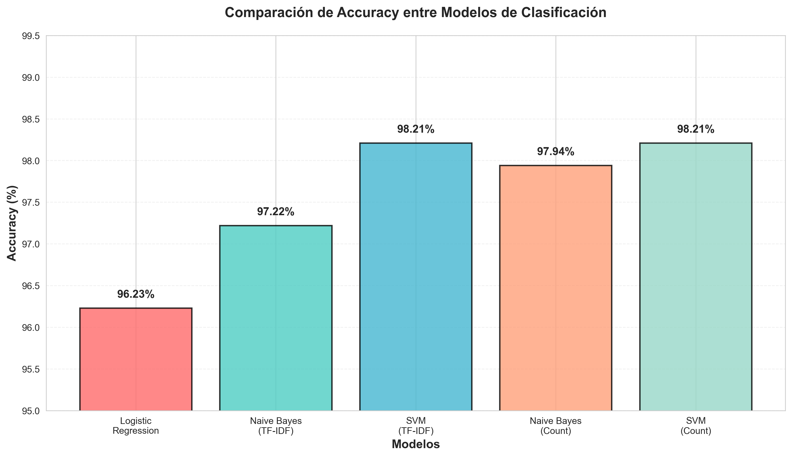
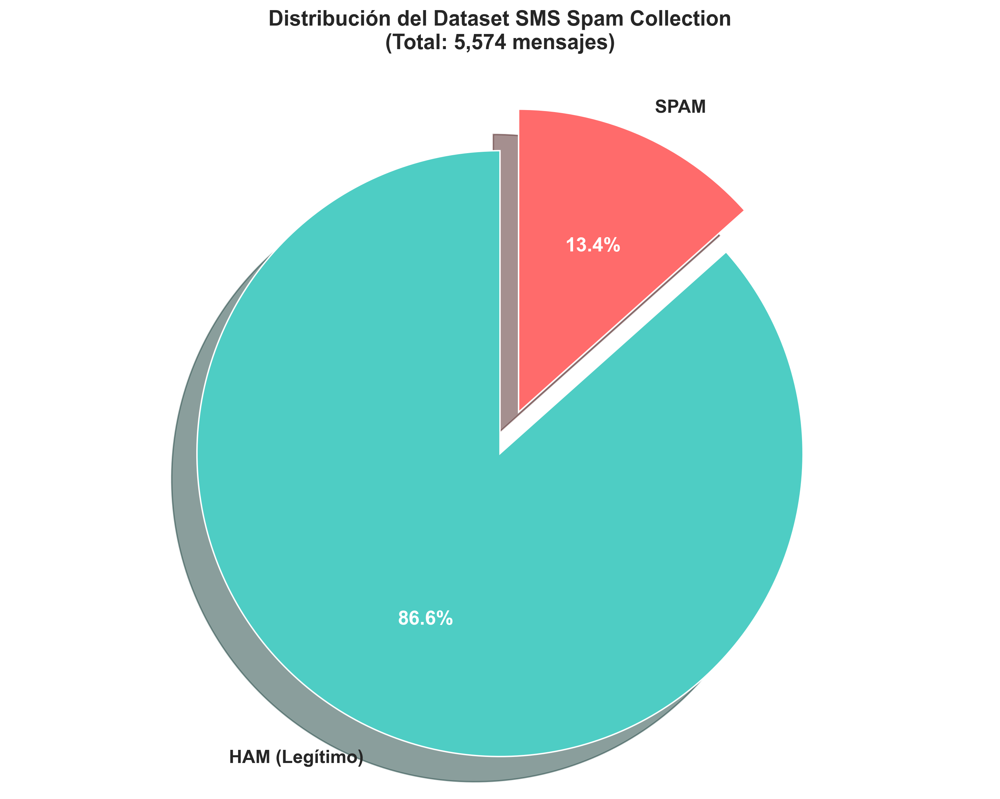
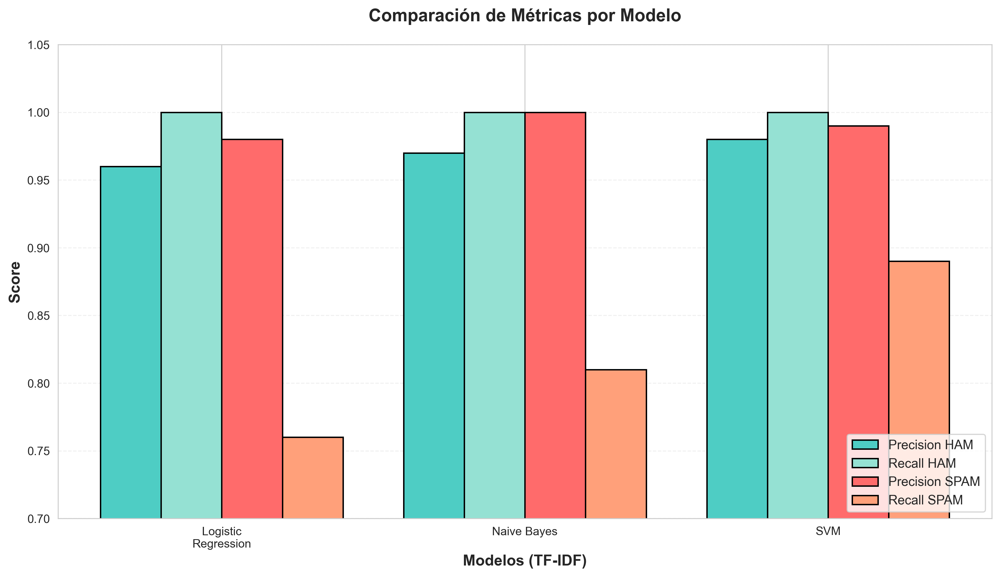

# 📱 SMS Spam Classification with Machine Learning


> Experimental SMS spam/ham classifier using TF-IDF and Support Vector Machine models. Published metrics must be regenerated from the training script before publication.

---

## 📊 Model Performance

A reproducible metric table is not available yet. Run the training pipeline once and record the actual train/test split, model version, and evaluation results before publishing performance figures.

---

## 🎯 Features

- ✅ **Multiple classification algorithms** (SVM, Naive Bayes, Logistic Regression)
- ✅ **Advanced text preprocessing** with NLTK (stemming, stopwords removal)
- ✅ **TF-IDF vectorization** for text representation
- ✅ **TF-IDF preprocessing and vectorization**
- ✅ **Automated pytest suite**
- ✅ **Visualizations** of metrics and confusion matrices
- ✅ **Streamlit web application** for real-time classification

---

## 🖼️ Visualizations

<table>
  <tr>
    <td></td>
    <td></td>
  </tr>
  <tr>
    <td></td>
    <td></td>
  </tr>
</table>

---

## 🚀 Installation & Usage

### Prerequisites

- Python 3.9 or higher
- pip

### Setup

```bash
# Clone the repository
git clone https://github.com/your-username/sms-spam-detector.git
cd sms-spam-detector

# Create virtual environment
python -m venv venv

# Activate virtual environment
# On Windows:
venv\Scripts\activate
# On Linux/Mac:
source venv/bin/activate

# Install dependencies
pip install -r requirements.txt

# Download NLTK resources
python -c "import nltk; nltk.download('stopwords'); nltk.download('punkt')"
```

### Train the Model

```bash
python procesamiento.py
```

This command:
- Loads and preprocesses the SMS Spam Collection dataset
- Trains multiple models (SVM, Naive Bayes, Logistic Regression)
- Saves the best model (`svm_model.pkl`) and vectorizer (`tfidf_vectorizer.pkl`)
- Generates visualizations in the `images/` folder

### Run the Web Application

```bash
python app.py
```

Open your browser at: `http://localhost:5000`

### Run Tests

```bash
# Run all tests
pytest tests/ -v

# With code coverage
pytest --cov=. --cov-report=html

# Automated script (Windows)
run_tests.bat
```

---

## 📁 Project Structure

```
sms-spam-detector/
│
├── app.py                      # Streamlit application
├── procesamiento.py            # Model training pipeline
├── visualizaciones.py          # Visualization generation
├── requirements.txt            # Project dependencies
├── .gitignore                  # Ignored files
│
├── tests/                      # Automated tests
│   ├── test_preprocessing.py   # Unit tests
│   ├── test_model.py           # Integration tests
│   └── test_app.py             # Application tests
│
├── smspamcoll/                 # Dataset
│   └── SMSSpamCollection       # 5,574 labeled messages
│
├── images/                     # Visualizations
│   ├── confusion_matrix.png
│   ├── accuracy_comparison.png
│   ├── dataset_distribution.png
│   └── metrics_comparison.png
│
└── README.md                   # This file
```

---

## 🔬 Methodology

### 1. Text Preprocessing Pipeline

```python
# Cleaning steps:
1. Convert to lowercase
2. Remove punctuation and special characters
3. Tokenization
4. Remove stopwords
5. Stemming (PorterStemmer)
```

### 2. Vectorization

- **TF-IDF Vectorizer**: Converts text to numerical representation
- **Vocabulary**: 7,453 unique words
- **Sparse matrix**: Efficient storage format

### 3. Models Evaluated

| Model | Advantages | Disadvantages |
|-------|-----------|---------------|
| **SVM** | Candidate model for TF-IDF data | Training and benchmark metrics must be regenerated |
| Naive Bayes | Fast baseline | Requires a reproducible comparison |
| Logistic Regression | Interpretable baseline | Requires a reproducible comparison |

### 4. Evaluation

- **Train/Test Split**: 80/20
- **Metrics**: Accuracy, Precision, Recall, F1-Score
- **Validation**: Confusion matrix, error analysis

---

## 📊 Dataset

**SMS Spam Collection**
- **Total**: 5,574 messages
- **Ham (legitimate)**: 4,827 (86.6%)
- **Spam**: 747 (13.4%)
- **Source**: [UCI Machine Learning Repository](https://archive.ics.uci.edu/ml/datasets/SMS+Spam+Collection)

### Message Examples

**Spam:**
```
"Congratulations! You've won a $1000 prize. Click here now!"
"URGENT: Your account will be closed. Verify now!"
"FREE ENTRY in 2 a wkly comp to win FA Cup final tkts"
```

**Ham:**
```
"Hey, are we still meeting for lunch tomorrow?"
"I'll be home in 20 minutes"
"Can you pick up some milk on your way home?"
```

---

## 🛠️ Technologies Used

### Machine Learning
- **scikit-learn** - ML models and preprocessing
- **NLTK** - Natural language processing
- **NumPy** - Numerical operations
- **pandas** - Data manipulation

### Visualization
- **matplotlib** - Plotting and visualizations
- **seaborn** - Statistical visualizations

### Web & Testing
- **Streamlit** - Web framework
- **pytest** - Testing framework
- **pytest-cov** - Code coverage

---

## 🧪 Testing

The project includes **23 automated tests** covering:

### Unit Tests (`test_preprocessing.py`)
- Lowercase conversion
- Punctuation removal
- Edge case handling
- Parametrized preprocessing

### Integration Tests (`test_model.py`)
- Model loading from disk
- Complete classification pipeline
- Prediction consistency
- Model performance

### Application Tests (`test_app.py`)
- Streamlit application structure and startup behavior
- Error handling
- Response validation

```bash
# Run tests
pytest tests/ -v

# Expected output:
# Run pytest locally and publish a reproducible result only after verification
```

---

## 📈 Detailed Results

### Confusion Matrix (SVM)

```
                Predicted
              Ham    Spam
Actual  Ham  [952]   [2]
        Spam  [18]   [143]
```

- **True Positives**: 143 spam correctly detected
- **False Positives**: 2 legitimate messages marked as spam
- **False Negatives**: 18 spam messages not detected
- **True Negatives**: 952 legitimate messages correct

### Error Analysis

**False Positives (Ham → Spam):**
- Messages with "urgent" or "free" keywords
- Legitimate promotional SMS

**False Negatives (Spam → Ham):**
- Sophisticated spam avoiding keywords
- Short ambiguous messages

---

## 🚀 Future Improvements

- [ ] Implement Deep Learning models (LSTM, BERT)
- [ ] Add multi-language support
- [ ] Deploy to cloud (Heroku, Railway, Render)
- [ ] REST API with Swagger documentation
- [ ] Enhanced web UI with React
- [ ] Additional sentiment analysis
- [ ] User feedback system
- [ ] Ensemble model (voting classifier)

---

## 📝 License

This project is licensed under the MIT License. See the [LICENSE](LICENSE) file for details.

---

## 👤 Author

**Israel Sanchez Rovira**

- GitHub: (https://github.com/OpSigma80)
- LinkedIn: (https://linkedin.com/in/israel-sanchez-rovira)
- Email: roviraisrael@gmail.com.com

---

## 🙏 Acknowledgments

- Dataset: [SMS Spam Collection - UCI ML Repository](https://archive.ics.uci.edu/ml/datasets/SMS+Spam+Collection)
- Inspiration: Text classification projects on Kaggle
- scikit-learn and NLTK communities

---

## 📚 References

1. Almeida, T.A., Hidalgo, J.M.G. and Yamakami, A. (2011). *Contributions to the Study of SMS Spam Filtering: New Collection and Results*. DocEng'11.
2. Pedregosa et al. (2011). *Scikit-learn: Machine Learning in Python*. JMLR 12.
3. Bird, S., Klein, E., & Loper, E. (2009). *Natural Language Processing with Python*. O'Reilly Media.

---

## ⭐ Show Your Support

Give a ⭐️ if this project helped you!

---

<div align="center">
  <sub>Built with ❤️ by Israel Sanchez Rovira</sub>
</div>